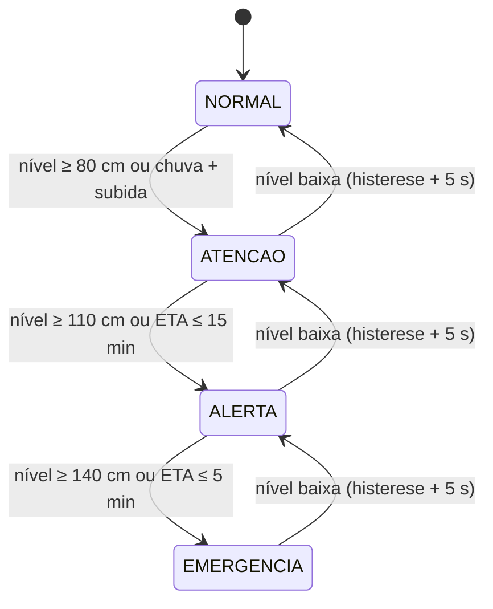

# CitizenTech_FloodSense

# Alerta de Enchente com Previsão de Transbordamento

Projeto feito com **Raspberry Pi Pico**, **MicroPython** e simulação no **Wokwi**.

> Em vez de apenas avisar quando a água passa de um limite, o sistema calcula a **velocidade de subida** do nível e estima **em quantos minutos o canal vai transbordar**, dando tempo para a população reagir.

**Simulação no Wokwi:** _cole aqui o link do projeto_
---

## 1. O problema
Enchentes e alagamentos causam mortes, perdas materiais, interrupção de serviços e isolamento de bairros inteiros nas cidades brasileiras. Os mais afetados são moradores de áreas próximas a córregos e várzeas, pessoas com mobilidade reduzida, idosos, crianças e comerciantes locais.

Em muitos pontos, o alerta só chega **depois** que a água já subiu. O que falta é **antecedência**: saber que o nível vai chegar ao limite nos próximos minutos, e não apenas que ele chegou.

## 2. A solução
Um nó de monitoramento de baixo custo que:

1. mede o nível da água com sensor ultrassônico;
2. considera a intensidade da chuva;
3. calcula a **tendência** (cm/min) e o **tempo estimado até o transbordo**;
4. classifica o risco em quatro estados e avisa por luz, som e display.

### Estados do sistema

| Estado | Condição de nível | LED | Buzzer |
|---|---|---|---|
| NORMAL | < 80 cm | Verde | Mudo |
| ATENÇÃO | ≥ 80 cm | Amarelo | Bipe lento |
| ALERTA | ≥ 110 cm | Vermelho fixo | Bipe médio |
| EMERGÊNCIA | ≥ 140 cm | Vermelho piscando | Bipe rápido |

O estado **sobe imediatamente**, inclusive por **antecipação** (ETA curto, ou chuva forte com nível subindo), e só **desce** depois que o nível fica abaixo do limite menos uma folga (**histerese** de 5 cm) por 5 segundos.

## 3. Componentes
| Componente | Função | Pino |
|---|---|---|
| Raspberry Pi Pico | Processamento | — |
| HC-SR04 | Mede a distância até a água (nível) | TRIG GP3, ECHO GP2 |
| Potenciômetro | Simula o pluviômetro (0 a 100 mm/h) | GP26 (ADC) |
| Display OLED SSD1306 | Nível, chuva, tendência, ETA e estado | SDA GP4, SCL GP5 |
| LEDs verde, amarelo, vermelho | Indicação visual do estado | GP10, GP11, GP12 |
| Buzzer | Alarme sonoro por padrões | GP15 |
| Botão TESTE | Autoteste de LEDs e buzzer | GP13 |
| Botão MUDO | Silencia o alarme por 30 s | GP14 |

O sensor fica 200 cm acima do fundo do canal: `nível = 200 − distância`. O transbordo é considerado em 150 cm.

## 4. Lógica do programa
- **Média de amostras e tendência:** janela de 20 leituras (10 s); a taxa é a diferença entre as médias da segunda e da primeira metade, em cm/min.
- **Previsão:** `ETA = (150 − nível) / taxa`.
- **Máquina de estados** com subida imediata e descida com histerese e tempo de espera.
- **Sem bloqueio:** o laço principal usa `ticks_ms()` e `ticks_diff()` em vez de esperas longas, então os botões respondem na hora.
- **Silêncio inteligente:** o botão MUDO cala o buzzer, mas o alarme volta se a situação piorar.
- **Tolerância a falhas:** se o sensor não responde, o display mostra `FALHA NO SENSOR`.

## 5. Impacto social
O sistema transforma um sensor simples em **alerta antecipado**. Em uma aplicação real, nós como este poderiam ficar em córregos, galerias e pontos críticos de alagamento, avisando moradores e equipes de Defesa Civil com minutos de antecedência. Esses minutos podem ser usados para evacuar pessoas vulneráveis, proteger bens e interditar vias.

## 7. Próximos passos
- Trocar para a **Raspberry Pi Pico W** e enviar os dados por Wi-Fi/MQTT para um painel de monitoramento.
- Alimentação por bateria e painel solar.
- Calibrar os limites com dados reais de cada ponto monitorado.
- Rede de vários sensores com visão geral por região.

## Créditos e licença
O driver `ssd1306.py` é baseado na biblioteca oficial do MicroPython (licença MIT).
Projeto acadêmico desenvolvido para a atividade **CitizenTech**
